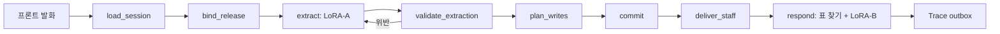

# survey-service (문진 서비스)

환자의 발화 한 턴을 받아 저장할 값으로 바꾸고, 다음에 할 말을 돌려주는 HTTP 서비스.

환자(키오스크 프론트)가 말하면 서비스가 세션을 만들거나 이어 받고, 추론 서버의 모델(LoRA-A)에게 값 추출을 시키고, 그 결과가 문항 규칙에 맞는지 검증해 저장한 뒤, 문장 틀 표를 찾아 모델(LoRA-B)이 응답 문장을 만들게 한다. 모든 턴의 기록(Trace)은 ops-feedback으로 보낸다. 같은 되묻기가 끝없이 반복되지 않게 하는 상한 장치와, 위험할 때 직원을 부르는 알림 길도 이 영역에 있다. **하지 않는 것**: 값의 정규화·판단(모델이 한다, 서비스는 검증만 한다), 모델 로딩·프롬프트(model-runtime), 문항·모델 승인(release-gate), 화면(프론트), 직원 콘솔 화면(docs/brief.md §1, docs/design.md §16).

## 전체 속의 위치

| 방향 | 이웃 | 인터페이스 | 내용 |
|---|---|---|---|
| 받음 | Frontend(키오스크) | I10 공개 API: `POST /v1/sessions`, `/v1/sessions/{id}/turns`, `/end`, `GET /v1/sessions/{id}/state` | 세션 시작, 발화, 종료. `turn_id`로 멱등 |
| 받음 | 직원 콘솔 | I10: `POST /v1/sessions/{id}/intervention`, `GET /v1/staff/alerts`, `/v1/staff/alerts/stream`(SSE), 푸시 구독 | 직원 개입(재개·종료), 알림 조회 |
| 받음 | release-gate | I4 ReleaseReader(HTTP 클라이언트) | 활성 포인터 폴링, 승인된 릴리스 묶음 적재 |
| 부름 | 추론 서버(model-runtime) | I9: `PUT /v1/releases/{id}`, `POST .../extract`, `POST .../respond` | LoRA-A 추출, LoRA-B 응답 |
| 부름 | turn-engine(라이브러리) | I8 | `validate_extraction`, `QuestionFlowTable` |
| 보냄 | ops-feedback | I6 TraceIngest `send(TraceEnvelope)` | 턴마다 한 건, 영속 outbox 경유, 최소 1회 |

출처: docs/boundary.md §2~3, docs/design.md §1, `survey_service/api.py`. 이웃의 SDK는 이 영역이 제공하지 않는다(SDK 인터페이스 없음, docs/brief.md §2).

## 구조

| 경로 | 역할 |
|---|---|
| `survey_service/orchestrator.py`, `graph.py` | 한 턴의 순서(LangGraph 노드), 처리 표, 쓰기 확정, 실패 신호 |
| `survey_service/api.py`, `service.py`, `settings.py` | 공개 API 라우팅, 조립·`/healthz` `/readyz`, 환경 변수 설정 |
| `survey_service/store/` | Session Store(SQLite·메모리), 저장 효과(순수 함수) |
| `survey_service/release/` | 릴리스 로더(승인·해시·버전 검사, 거부 시 이전 유지) |
| `survey_service/extraction.py`, `flow.py`, `response_tables.py`, `assembly.py` | A 입력 조립, 문항 순서·건너뛰기 표, 표 찾기(B 입력) |
| `survey_service/inference.py`, `remote.py`, `clients.py` | 추론 서버 HTTP 호출, 이웃 HTTP 클라이언트 |
| `survey_service/alerts.py`, `ports.py` | 직원 알림 저장·전달, 바깥 접점 포트(`RiskSource` 등) |
| `survey_service/trace/` | TurnTrace 조립, outbox, 전송 스레드 |
| `schema/` | 문진 스키마(이 영역이 소유, 정수 버전 1). 문항 흐름·표 찾기 표 데이터 포함 |
| `tests/` | 시험과 이웃 대역(참조 서버, 가짜 입력원) |
| `scripts/` | `smoke.sh`(이미지 스모크), `smoke_compose.sh`, `build_wheels.sh` |
| `Dockerfile`, `requirements.txt`, `requirements.lock` | 이미지와 의존 고정 |

한 턴의 흐름(docs/design.md §16):



위반이면 같은 요청을 1회만 재시도하고(D75), 그래도 틀리면 턴 실패(`NOT_COMMITTED`)로 세션을 바꾸지 않는다. 시작·직원 재개/종료·이탈 턴은 A를 부르지 않는다.

## 실행 방법

전제: Python 3.10 이상, git(이웃 리포 `../boundary-contracts`, `../turn-engine`, `../model-runtime`가 옆에 있어야 설치된다), 스모크에는 Docker 데몬 접근 권한. 아래 `pip install` 줄은 docs/runbook.md §5 그대로다.

```bash
# 1) 설치
python3 -m venv .venv && .venv/bin/pip install -e ../boundary-contracts ../turn-engine ../model-runtime -e schema -e . pytest pyyaml
# 2) 시험
.venv/bin/python -m pytest
# 3) 이미지 스모크 (빌드 + /healthz /readyz + 비root + 라벨 + 한 턴)
bash scripts/smoke.sh
# 4) 서비스 + 가짜 추론 + 가짜 게이트 compose 스모크
bash scripts/smoke_compose.sh
# 5) 실행: 필수 환경 변수 3개(없으면 종료 코드 2)
SURVEY_RELEASE_READER=http SURVEY_TRACE_INGEST=http SURVEY_MODEL_BACKEND=fake python -m survey_service
```

비밀(API 토큰, VAPID 키 등)은 값을 환경 변수에 직접 넣지 않고 `NAME_FILE`(파일 경로)로 받는다(D84, docs/runbook.md §1). 이름 목록과 나머지 설정은 runbook §1. 실제 운영 실행에는 release-gate·ops-feedback·추론 서버 URL과 토큰 파일이 더 필요하다(설정 전체는 runbook 참조, 이 문서는 개발용 최소만 적었다).

이 세션에서 **돌려 본 것**: `.venv/bin/python -m pytest --collect-only -q`(수집만, 합계 415개), `.venv/bin/python -m survey_service --help`(필수 환경 변수 누락 오류 메시지 확인).
이 세션에서 **돌리지 않은 것**: 위 1)의 설치, 2)의 시험 실행, 3), 4), 5)의 실제 기동. 명령은 문서(runbook, scripts)에서 옮겼다.

## 현재 상태

- 문서가 기록한 결과(docs/STATUS.md 마지막 기록): pytest 403 통과, `smoke.sh` OK, `smoke_compose.sh` OK, 모두 "이 PC 한 곳"에서만 확인.
- 수집 결과는 415개이고 STATUS의 403은 구간 8 당시 값이다(STATUS "현재 기준"에 정리). 415개의 통과 여부는 돌리지 않아 미확인.
- 확인하지 못한 것(STATUS, OPEN_GAPS): 실제 model-runtime 서버 이미지와의 E2E, 두 번째 깨끗한 환경에서의 재현, 실제 브라우저·푸시 서비스, 실제 모델로 한 턴을 통과시키는 일(U07), 부하·동시성, 세션 문서 암호화·보존 기간.
- 표 찾기는 데이터셋 담당의 규칙(학습 서버 labels.py, 2026-10-14)을 옮긴 것이고 확인 대기다(`schema/data/response_tables.json`의 `table_status: DATASET_RULES_UNCONFIRMED`, 승인 기록 미확인).
- `/readyz`는 PostgreSQL이 죽거나 응답이 없어도 `SURVEY_READYZ_DB_TIMEOUT_SECONDS`(기본 2초)+약 2초 안에 503(db unavailable)으로 답하고 복구 뒤 200이 된다(CR-D23, docs/boundary.md §5·§6). 이 PC에서 로컬 PostgreSQL 컨테이너로 확인했고, 실제 compose 환경의 재측정은 deploy E2E 5p에서 헤드가 한다.
- 직원 알림 API·SSE·푸시는 살아 있으나 알림을 만드는 입력원이 없어 알림은 나오지 않는다(`/readyz`의 `staff_alert_source.active=false`, docs/boundary.md §5).

## 이 영역의 열린 항목 (head/docs/OPEN_GAPS.md, 읽기 전용으로 확인)

| ID | 요약 | 막는 것 |
|---|---|---|
| G01 | 직원 알림의 입력원이 없다. 포트(`SURVEY_RISK_SOURCE`)와 시험은 있고 입력원은 비어 있다. 환자 안전과 닿는다 | 사용자 결정 |
| G12 | 재질문 상한: 메커니즘(`SURVEY_MAX_CONSECUTIVE_REASK`, 기본 0=끔)은 구현됨. 값 N과 정지 이름 재사용 여부 미정, 지금은 무한 되묻기 가능 | 사용자 결정 |
| G03 | 표 찾기는 데이터셋 담당의 labels.py 규칙을 옮김, 표 승인 기록 미확인(IO_SPEC 7장 2번 미정) | 다른 영역(데이터셋 담당 확인) |
| G13 | 표 `DATASET_RULES_UNCONFIRMED`, 57행 문제용 `next.text`를 B 모델이 어떻게 다루는지 미확인, A 입력 state 묶음 순서 13/549행 불일치 | 다른 영역(데이터셋)·GPU(모델 확인) |
| G11 | 정수 버전 1 안에서 비호환 변경. ops-feedback과 같은 잠금으로 함께 배포해야 한다 | 다른 영역(ops-feedback), 사용자 결정 |
| U07 | 실제 LLM 데모에서 학습 안 된 모델이 없는 slot key를 지어내 14턴 모두 실패 | GPU·학습 쪽 |
| U14 | 제약 디코딩이 slot key를 현재 문항 범위로 제한하지 못함(계약 변경 필요) | 헤드 판단 대기(계약), 다른 영역 |
| D-E | 회귀 평가가 읽는 v2 TurnTrace 입력 키 이름이 추정(이 영역 확정 후) | 다른 영역(평가 쪽)이 이 영역의 확정을 기다림 |

G07은 닫힘이라 뺐다. 위 요약은 대장의 한 줄을 줄인 것이며 원문 상태는 대장이 기준이다.

## 더 자세한 문서

| 문서 | 내용 |
|---|---|
| `CLAUDE.md` | 이 리포 에이전트 지침 |
| `docs/brief.md` | 영역 브리프: 목적, 범위, 수용 기준, 건드리면 안 되는 경계 |
| `docs/design.md` | 내부 설계서(1~15절 v1 시절 일부 폐기, 현재 구조는 16~19절) |
| `docs/boundary.md` | 소유 저장소, 제공·소비 계약과 버전, 이웃에게 지키는 것, 장애 영향 |
| `docs/runbook.md` | 환경 변수, 상태 보기, 실패 대처, 이미지, 스모크 |
| `docs/STATUS.md` | 구간별 한 일, 시험 결과, 한계 |
| `docs/CHANGELOG.md` | 변경 이력 |
| `docs/inference-server-spec.md` | 추론 서버 HTTP 규약 |
| `docs/change-requests/` | 헤드에게 보낸 변경 요청(CR-001~012) |
| `docs/rules/` | 헤드가 전달한 업무 규칙과 입력 조립 표 |
